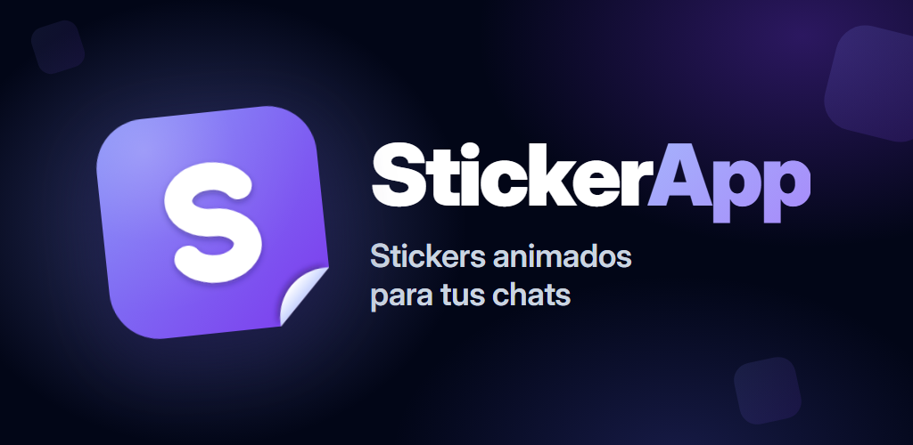

# StickerApp

[](https://github.com/eduardolar/StickerApp/actions/workflows/ci.yml)   

App para buscar stickers animados, guardar favoritos y compartirlos. Hecha con **Angular 22** y empaquetada para Android con **Capacitor 8**. Es un proyecto personal.

## Qué hace

- **Tendencias** al abrir, con carga infinita al hacer scroll.
- **Búsqueda en vivo** mientras escribes, con historial de las 10 últimas búsquedas.
- **Favoritos** guardados en el móvil, con su propio buscador.
- **Vista grande** con navegación entre stickers.
- **Compartir, guardar y copiar el enlace** con los plugins nativos de Capacitor (Share, Filesystem, Clipboard).
- **Modo claro y oscuro**, siguiendo el del sistema por defecto.
- Anuncios con AdMob y consentimiento para el Espacio Económico Europeo.

Los stickers vienen de la API de [KLIPY](https://partner.klipy.com), con su filtro de contenido más estricto.

## Tecnologías

Angular 22 (componentes standalone y signals) · TypeScript · Capacitor 8 · Vitest

## Cómo probarla

1. Copia `src/environments/environment.example.ts` como `environment.ts` y `environment.development.ts`, y pon tu clave de KLIPY.
2. Instala y arranca:

```bash
npm install
npm start
```

3. Pruebas: `npm test`.

Para Android hacen falta Android Studio y un `android/keystore.properties` propio (no está en el repositorio).

StickerApp es independiente: no está afiliada a WhatsApp, Meta ni KLIPY.
